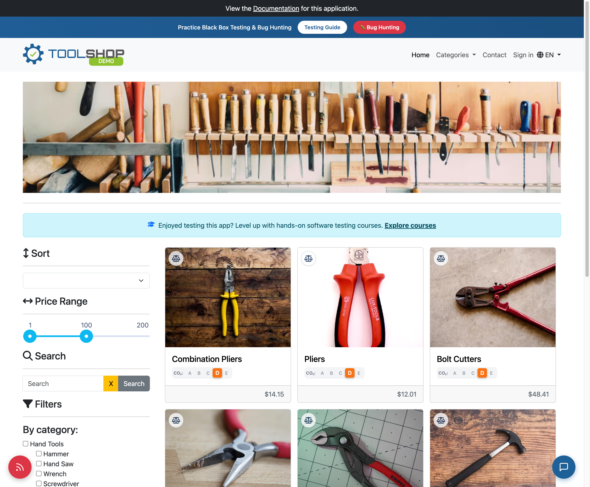
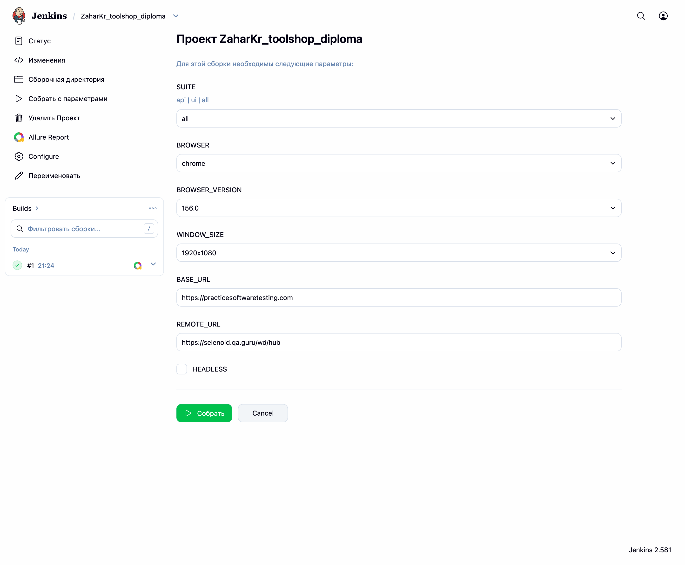
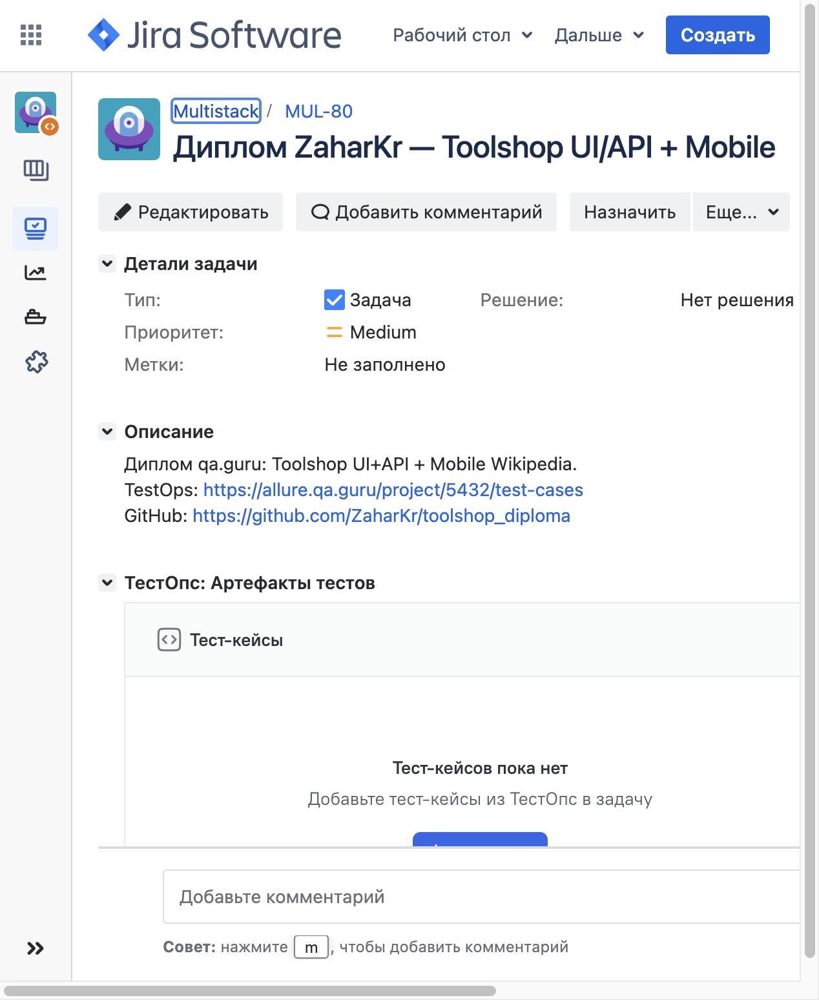
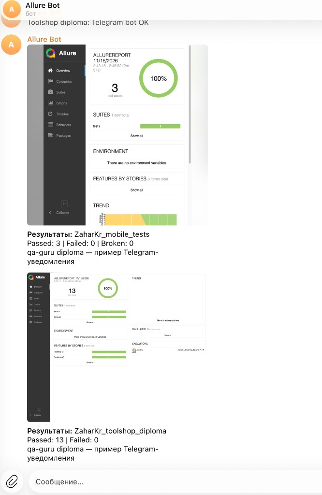

# Toolshop — UI + API автотесты

Автоматизация [Practice Software Testing / Toolshop](https://practicesoftwaretesting.com)  
Python · Pytest · Selenium · Requests · Pydantic · JSON Schema · Allure · Selenoid · Jenkins · Telegram



<p align="left">
  
  
  
  
  
  
  
  
  
  
</p>

### Используемые инструменты

<p align="left">
  
  &nbsp;
  
  &nbsp;
  
  &nbsp;
  
  &nbsp;
  
  &nbsp;
  
</p>

| | |
|---|---|
| UI | https://practicesoftwaretesting.com |
| API / Swagger | https://api.practicesoftwaretesting.com/api/documentation |
| GitHub | https://github.com/ZaharKr/toolshop_diploma |
| Jenkins | https://jenkins.qa.guru/job/ZaharKr_toolshop_diploma/ |
| Allure | https://jenkins.qa.guru/job/ZaharKr_toolshop_diploma/allure |
| TestOps | https://allure.qa.guru/project/5432/test-cases |
| Jira | https://jira.qa.guru/browse/MUL-80 |
| Mobile | https://github.com/ZaharKr/mobile_tests |
| Mobile Jenkins | https://jenkins.qa.guru/job/ZaharKr_mobile_tests/10/ |

## Содержание

- [Покрытие](#покрытие)
- [Структура](#структура)
- [Локальный запуск](#локальный-запуск)
- [Jenkins](#jenkins)
- [Allure Report](#allure-report)
- [Allure TestOps](#allure-testops)
- [Jira](#jira)
- [Telegram](#telegram)
- [Сценарий UI](#сценарий-ui)
- [Mobile](#mobile)

## Покрытие

**16 автотестов** в одном репозитории: **8 UI** + **8 API**.  
Перед частью UI-сценариев — подготовка сессии и корзины по API (JWT → `localStorage`, cart → `sessionStorage`).  
Ответы API дополнительно валидируются по **JSON Schema**.

### Список проверок (API)

1. Успешный логин → `access_token` + schema
2. Логин с неверным паролем → 400/401 + schema
3. Регистрация уникального пользователя + логин
4. Список продуктов + schema
5. Продукт по id + schema
6. Несуществующий продукт → 404 + schema
7. Создание корзины и добавление товара + schema
8. Удаление товара из корзины и удаление корзины

### UI

| Сценарий | Что проверяет |
|----------|---------------|
| Успешный логин | Вход, меню пользователя |
| Невалидный логин | Ошибка при неверных данных |
| Поиск | Результаты по названию |
| Категория | Фильтр каталога |
| Карточка товара | Product page |
| Корзина (API → UI) | Товар из API уже в UI |
| Add to cart | Добавление после API-login |
| Профиль | Меню после JWT в localStorage |

### API

| Метод | Endpoint | Schema |
|-------|----------|--------|
| POST | `/users/login` | `login_response.json` / `error.json` |
| POST | `/users/register` | `register_response.json` |
| GET | `/products` | `products_list.json` |
| GET | `/products/{id}` | `product.json` / `error.json` |
| POST | `/carts` + add item | `cart_create.json` / `cart.json` |
| DELETE | cart product / cart | — |

Request/response — pydantic-модели + JSON Schema. Page Object для UI.

## Структура

```
toolshop_diploma/
  pages/            # Page Object
  api/              # HTTP-клиент
  models/           # pydantic
  json_schemas/     # контракты ответов API
  utils/            # Allure attach, schema validate, API-prep для UI
tests/
  ui/
  api/
media/              # скрины, GIF
jenkins/            # shell для CI
```

## Локальный запуск

```bash
git clone https://github.com/ZaharKr/toolshop_diploma.git
cd toolshop_diploma
python3 -m venv .venv
source .venv/bin/activate
pip install -r requirements.txt
cp .env.example .env
```

`.env`:

```env
SELENOID_LOGIN=user1
SELENOID_PASSWORD=1234
```

```bash
# все
pytest

# только API
pytest -m api

# только UI в Selenoid
pytest -m ui \
  --base-url=https://practicesoftwaretesting.com \
  --remote-url=https://selenoid.qa.guru/wd/hub \
  --browser=chrome \
  --browser-version=156.0 \
  --window-size=1920x1080

allure serve allure-results
```

В Allure: steps, screenshot, page source, browser logs, video (Selenoid), JSON Schema steps.

## Jenkins

> [Ссылка на сборку в Jenkins](https://jenkins.qa.guru/job/ZaharKr_toolshop_diploma/)

1. Freestyle, label `python`
2. Git → этот репозиторий, `*/main`
3. Parameters: `SUITE` (`api` / `ui` / `all`), `BROWSER`, `BROWSER_VERSION`, `WINDOW_SIZE`, `BASE_URL`
4. Create Text File → `.env` (Selenoid)
5. Shell — `jenkins/job-shell.sh`
6. Post-build: Allure Report (`allure-results`)
7. Telegram: allure-notifications **4.11.1**



## Allure Report


## Allure TestOps

Проект: https://allure.qa.guru/project/5432/test-cases  

Ручные кейсы (smoke, регистрация, корзина, поиск, язык) + автопрогоны из Jenkins.


## Jira

> [MUL-80](https://jira.qa.guru/browse/MUL-80) — задача диплома + ссылка на TestOps.



## Telegram

Уведомление бота после прогона (Allure chart → Telegram):



## Сценарий UI

Поиск → карточка → корзина:


## Mobile

Отдельный репозиторий: [mobile_tests](https://github.com/ZaharKr/mobile_tests)  
Appium · Wikipedia · BrowserStack + local · pydantic-конфиги.

Jenkins: [#10 SUCCESS — 3 passed](https://jenkins.qa.guru/job/ZaharKr_mobile_tests/10/)  
Allure: https://jenkins.qa.guru/job/ZaharKr_mobile_tests/10/allure
