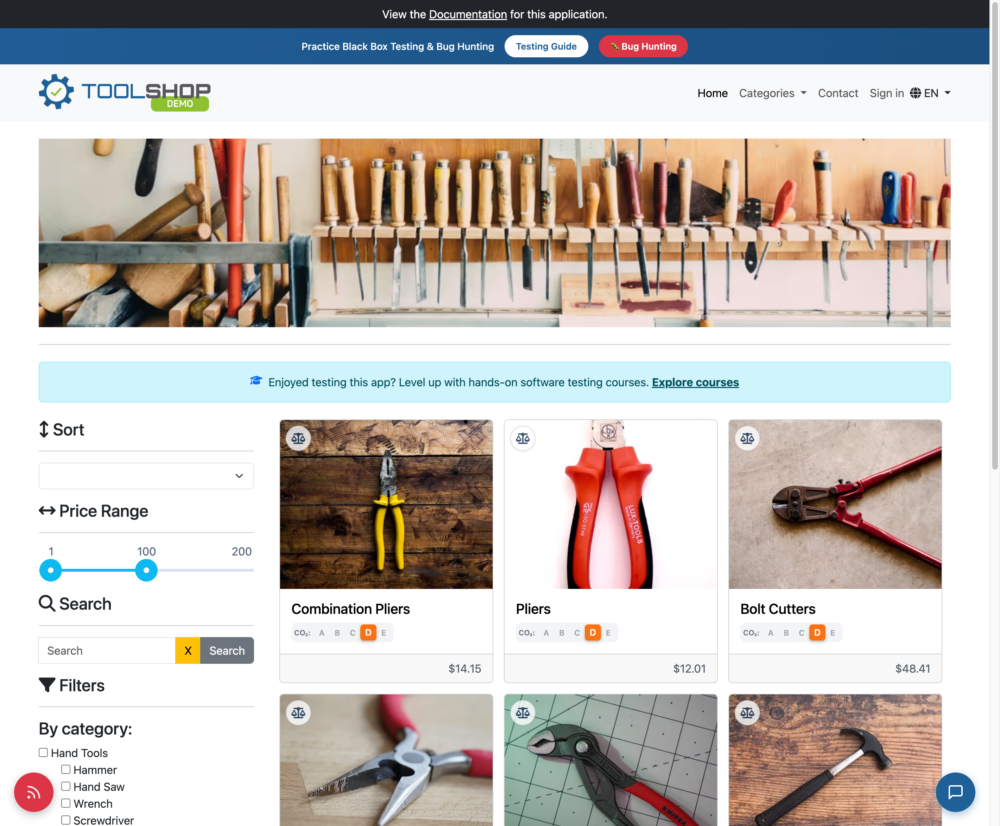
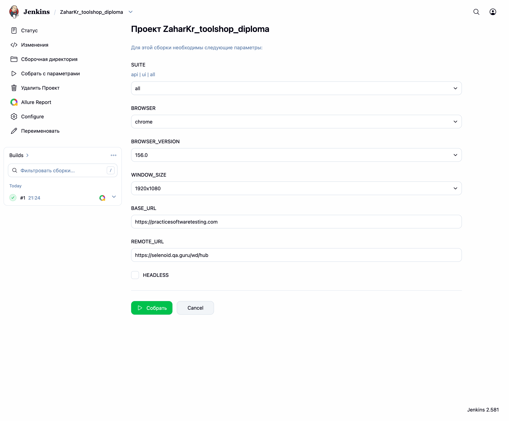
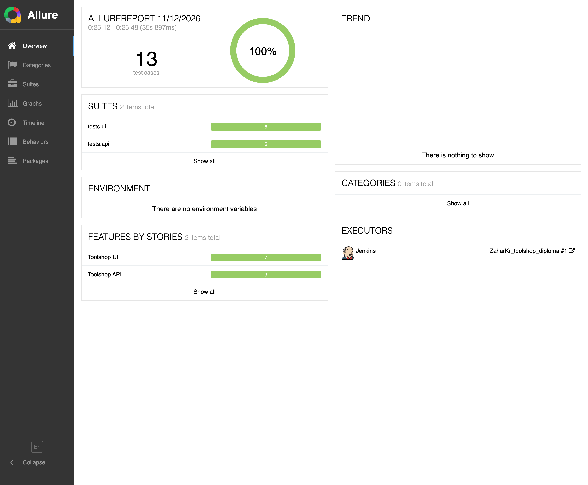

# Toolshop — UI + API автотесты

Автоматизация интернет-магазина [Practice Software Testing](https://practicesoftwaretesting.com)  
(Python, Selenium, Pytest, Requests, Pydantic, Allure, Selenoid, Jenkins, Telegram).




- **UI:** https://practicesoftwaretesting.com  
- **API / Swagger:** https://api.practicesoftwaretesting.com/api/documentation  
- **GitHub:** https://github.com/ZaharKr/toolshop_diploma  
- **Jenkins:** https://jenkins.qa.guru/job/ZaharKr_toolshop_diploma/  
- **Allure:** https://jenkins.qa.guru/job/ZaharKr_toolshop_diploma/allure  
- **TestOps:** https://allure.qa.guru/project/5432/test-cases  

## Стек

Python · Pytest · Selenium WebDriver · Requests · Pydantic · Allure Report · Selenoid · Jenkins · Telegram (allure-notifications 4.11.1)

## Покрытие

### UI

| Сценарий | Что проверяет |
|----------|---------------|
| Успешный логин | Вход в аккаунт, меню пользователя |
| Невалидный логин | Ошибка при неверных данных |
| Поиск | Результаты поиска по названию |
| Категория | Фильтр каталога |
| Карточка товара | Открытие product page |
| Корзина (API → UI) | Сессия и товар из API уже в UI |
| Add to cart | Добавление товара после API-login |
| Профиль | Меню после записи JWT в localStorage |

### API

| Метод | Endpoint |
|-------|----------|
| GET | `/products` |
| GET | `/products/{id}` |
| POST | `/users/login` |
| POST | `/carts` + add item |
| DELETE | cart product / cart |

Тела запросов и ответы описаны pydantic-моделями.  
Перед UI-сценариями: login → JWT в `localStorage`, корзина → `sessionStorage`.

## Структура

```
toolshop_diploma/
  pages/          # Page Object
  api/            # HTTP-клиент
  models/         # pydantic
  utils/          # attach, session prep
tests/
  ui/
  api/
```

## Установка

```bash
git clone https://github.com/ZaharKr/toolshop_diploma.git
cd toolshop_diploma
python3 -m venv .venv
source .venv/bin/activate
pip install -r requirements.txt
cp .env.example .env
```

В `.env` — логин/пароль Selenoid:

```env
SELENOID_LOGIN=user1
SELENOID_PASSWORD=1234
```

## Запуск

Все тесты:

```bash
pytest
```

Только API:

```bash
pytest -m api
```

Только UI (Selenoid):

```bash
pytest -m ui \
  --base-url=https://practicesoftwaretesting.com \
  --remote-url=https://selenoid.qa.guru/wd/hub \
  --browser=chrome \
  --browser-version=156.0 \
  --window-size=1920x1080
```

| Ключ | Описание |
|------|----------|
| `--base-url` | UI |
| `--api-url` | API base (фикстура клиента) |
| `--remote-url` | Selenoid hub |
| `--browser` / `--browser-version` | chrome / firefox |
| `--window-size` | например `1920x1080` |

### Allure

```bash
allure serve allure-results
```

В отчёте: steps, screenshot, page source, browser logs, video (Selenoid).

## Jenkins

Job: https://jenkins.qa.guru/job/ZaharKr_toolshop_diploma/

1. Freestyle, label `python`
2. Git → этот репозиторий, `*/main`
3. Parameters: `SUITE` (`api` / `ui` / `all`), `BROWSER`, `BROWSER_VERSION`, `WINDOW_SIZE`
4. Create Text File → `.env` (Selenoid)
5. Shell — `jenkins/job-shell.sh`
6. Post-build: Allure Report (`allure-results`)
7. Telegram: allure-notifications **4.11.1** (token в credentials Jenkins)



## Allure Report



## Allure TestOps / Jira

Автопрогоны и ручные кейсы: [TestOps](https://allure.qa.guru/project/5432/test-cases).  
Связь с задачами: [Jira qa.guru](https://jira.qa.guru/).

## Mobile

Отдельный репозиторий: [mobile_tests](https://github.com/ZaharKr/mobile_tests)  
(Appium, Wikipedia, BrowserStack + local).
