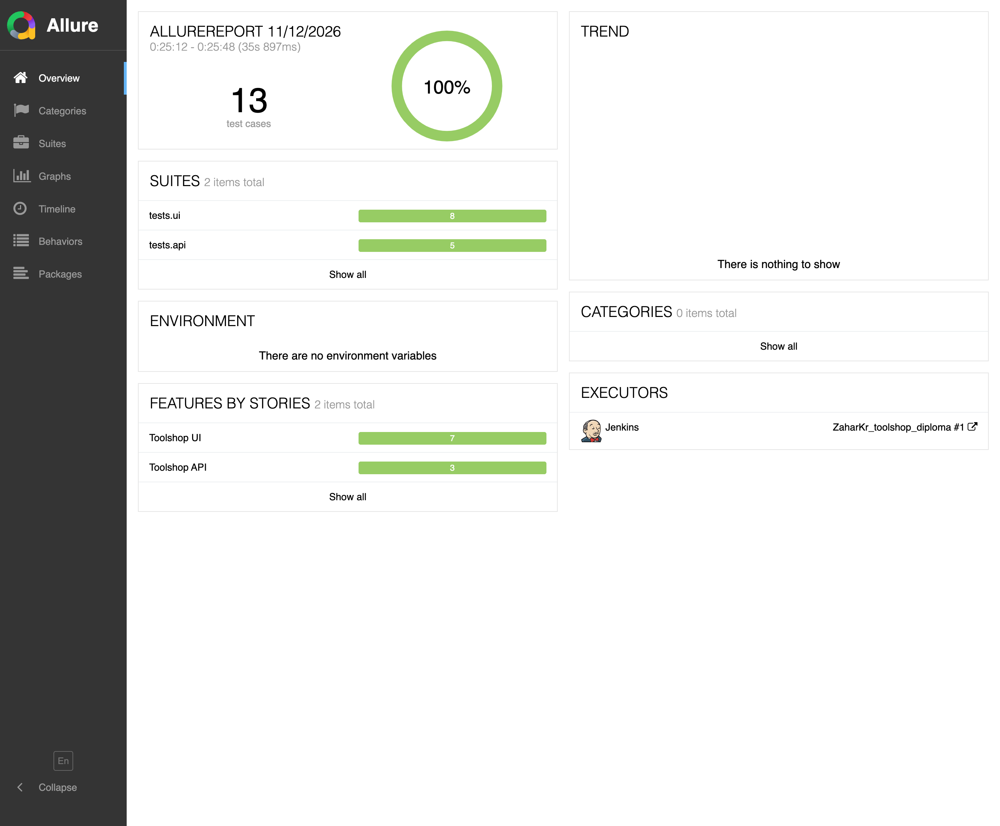
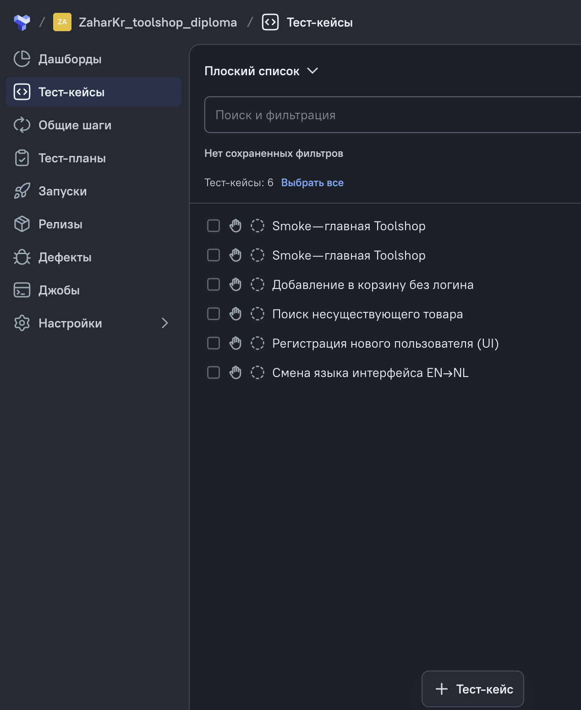
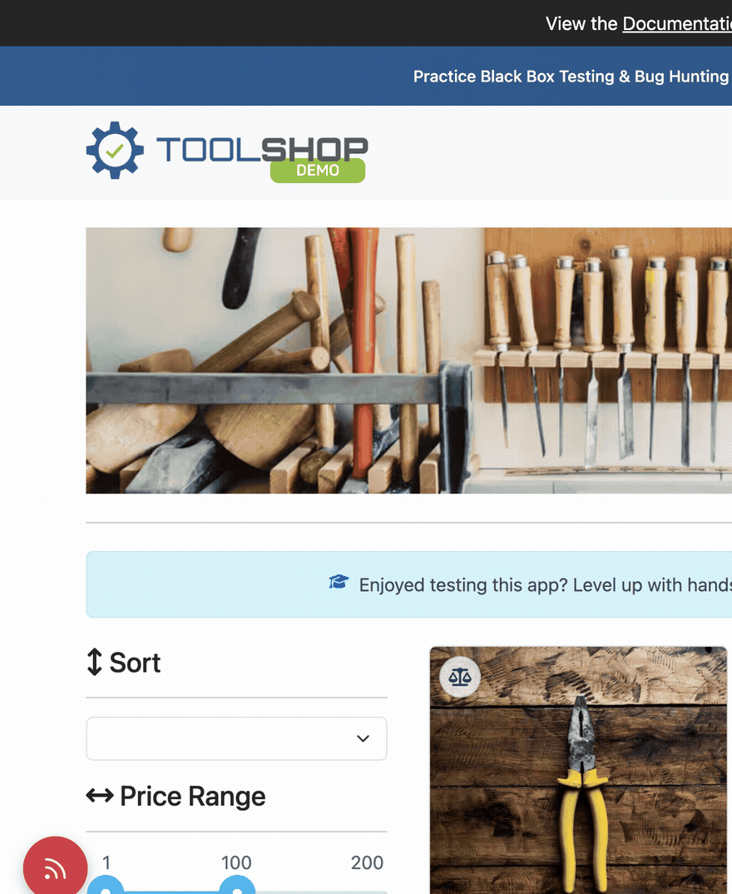

# Toolshop — UI + API автотесты

Автоматизация [Practice Software Testing / Toolshop](https://practicesoftwaretesting.com)  
Python · Pytest · Selenium · Requests · Pydantic · Allure · Selenoid · Jenkins · Telegram


<p align="left">
  
  
  
  
  
  
  
  
  
</p>

| | |
|---|---|
| UI | https://practicesoftwaretesting.com |
| API / Swagger | https://api.practicesoftwaretesting.com/api/documentation |
| GitHub | https://github.com/ZaharKr/toolshop_diploma |
| Jenkins | https://jenkins.qa.guru/job/ZaharKr_toolshop_diploma/ |
| Allure | https://jenkins.qa.guru/job/ZaharKr_toolshop_diploma/allure |
| TestOps | https://allure.qa.guru/project/5432/test-cases |
| Mobile | https://github.com/ZaharKr/mobile_tests |

## Содержание

- [Покрытие](#покрытие)
- [Структура](#структура)
- [Локальный запуск](#локальный-запуск)
- [Jenkins](#jenkins)
- [Allure Report](#allure-report)
- [Allure TestOps](#allure-testops)
- [Сценарий UI](#сценарий-ui)
- [Mobile](#mobile)

## Покрытие

**13 автотестов** в одном репозитории: **8 UI** + **5 API**.  
Перед частью UI-сценариев — подготовка сессии и корзины по API (JWT → `localStorage`, cart → `sessionStorage`).

### UI

| Сценарий | Что проверяет |
|----------|---------------|
| Успешный логин | Вход, меню пользователя |
| Невалидный логин | Ошибка при неверных данных |
| Поиск | Результаты по названию |
| Категория | Фильтр каталога |
| Карточка товара | Product page |
| Корзина (API → UI) | Товар из API уже в UI |
| Add to cart | Добавление после API-login |
| Профиль | Меню после JWT в localStorage |

### API

| Метод | Endpoint |
|-------|----------|
| GET | `/products` |
| GET | `/products/{id}` |
| POST | `/users/login` |
| POST | `/carts` + add item |
| DELETE | cart product / cart |

Request/response — pydantic-модели. Page Object для UI.

## Структура

```
toolshop_diploma/
  pages/          # Page Object
  api/            # HTTP-клиент
  models/         # pydantic
  utils/          # Allure attach, API-prep для UI
tests/
  ui/
  api/
media/            # скрины, GIF
jenkins/          # shell для CI
```

## Локальный запуск

```bash
git clone https://github.com/ZaharKr/toolshop_diploma.git
cd toolshop_diploma
python3 -m venv .venv
source .venv/bin/activate
pip install -r requirements.txt
cp .env.example .env
```

`.env`:

```env
SELENOID_LOGIN=user1
SELENOID_PASSWORD=1234
```

```bash
# все
pytest

# только API
pytest -m api

# только UI в Selenoid
pytest -m ui \
  --base-url=https://practicesoftwaretesting.com \
  --remote-url=https://selenoid.qa.guru/wd/hub \
  --browser=chrome \
  --browser-version=156.0 \
  --window-size=1920x1080

allure serve allure-results
```

В Allure: steps, screenshot, page source, browser logs, video (Selenoid).

## Jenkins

Job: https://jenkins.qa.guru/job/ZaharKr_toolshop_diploma/

1. Freestyle, label `python`
2. Git → этот репозиторий, `*/main`
3. Parameters: `SUITE` (`api` / `ui` / `all`), `BROWSER`, `BROWSER_VERSION`, `WINDOW_SIZE`, `BASE_URL`
4. Create Text File → `.env` (Selenoid)
5. Shell — `jenkins/job-shell.sh`
6. Post-build: Allure Report (`allure-results`)
7. Telegram: allure-notifications **4.11.1**


## Allure Report



## Allure TestOps

Проект: https://allure.qa.guru/project/5432/test-cases  

Ручные кейсы (smoke, регистрация, корзина, поиск, язык) + автопрогоны из Jenkins.



Jira: https://jira.qa.guru/

## Сценарий UI

Поиск → карточка → корзина:



## Mobile

Отдельный репозиторий: [mobile_tests](https://github.com/ZaharKr/mobile_tests)  
Appium · Wikipedia · BrowserStack + local · pydantic-конфиги.
